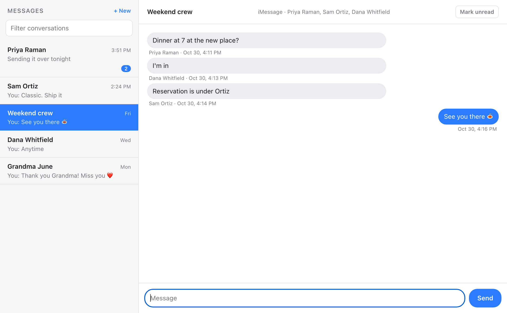

# messages-proxy

A web-based iMessage/SMS frontend you can run locally or proxy over the network. A Mac that is
signed in to Messages.app does the real work; any browser can then read and send through it.
Useful when the computer in front of you can't run Messages: a locked-down work machine, Windows,
Linux, a Chromebook, or anything else with a browser.



*Screenshot uses invented contacts and messages.*

## How it works

- **Reading:** opens `~/Library/Messages/chat.db` read-only and serves threads as JSON.
  It never writes to `chat.db`; unread state lives in its own `state.db`.
- **Sending:** hands text to Messages.app through AppleScript (`send.applescript`,
  `new.applescript`). Text is passed as an argument, never spliced into script source.
- **UI:** a single inline page served by `server.py`. Python standard library only, with no
  dependencies and no CDN assets.

Also: contact names from Contacts and iMessage shared names, HEIC-to-JPEG image previews,
recipient autocomplete, unread badges, and an installable home-screen app.

## Requirements

- macOS with Messages.app signed in
- `/usr/bin/python3` (3.9+)
- **Full Disk Access** (to read `chat.db`) and **Automation → Messages** (to send) for
  whatever launches the server

## Run

```sh
python3 server.py                    # http://<host>:8787
IMSG_TOKEN=secret python3 server.py  # then open /?t=secret
```

| Variable | Default | Meaning |
| --- | --- | --- |
| `IMSG_PORT` | `8787` | listen port |
| `IMSG_BIND` | `0.0.0.0` | listen address |
| `IMSG_TOKEN` | unset | if set, requests need `?t=<token>` once, then a session cookie |

To keep it running, `keepalive.sh` restarts the server and caps the log; run it from cron every
minute. Cron is used instead of launchd because it inherits the TCC grants listed above.

## Security

This exposes your whole message history and the ability to send as you.

- **Always set a token** if the server is reachable beyond a trusted LAN. `keepalive.sh` reads
  one from a mode-600 `token` file.
- Remote access works with a Tailscale Funnel. Funnel hostnames appear in Certificate
  Transparency logs and get scanned within minutes, so never expose one without a token.
- Attachment paths must resolve inside Messages' `Attachments` or `StickerCache` folders.
- The UI keeps threads in memory only and writes nothing to the browser's disk.

## Limits

- A new **group** thread can't be created from a script on current macOS; sending to several
  people only works when a thread with exactly those people already exists.
- Messages whose only content is a link preview show as "attachment unavailable".

Implementation notes and the reasoning behind them are in [AGENTS.md](AGENTS.md).
